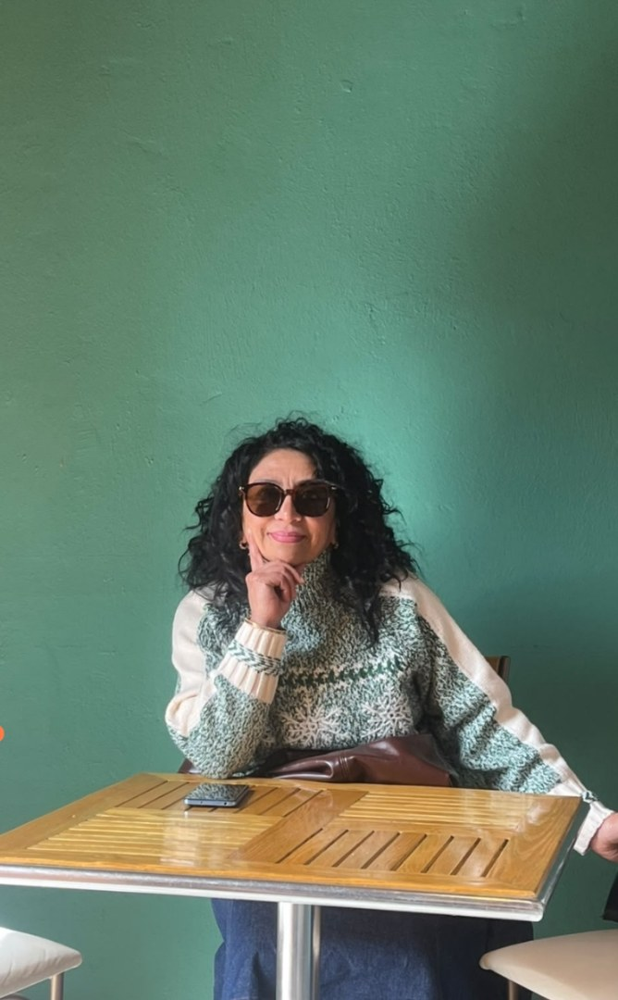

# El club que acompaña

Hoy cierran las inscripciones del concurso, se presenta el programa de mentoría, se reconoce al socio de octubre y dos socios nuevos toman protesta.

<!--
**Antes de empezar (18:15)**

- Abre la presentación con `npm run dev` y la vista del presentador en tu laptop (`/presenter`): las notas de cada lámina son el guión y no se proyectan.
- **Víctor reportó `NO_DISPONIBLE` hoy.** Este deck está escrito para que lo presente alguien más; donde haga falta un dato que solo él tiene, la nota lo dice.
- **Revisa dos cosas con él por WhatsApp antes de proyectar:** cuántas personas hay inscritas en el concurso (lámina 3) y si el tope publicado se sostiene (nota de la lámina 3).
- Cuatro bloques, ~20 minutos en total dentro de una sesión ordinaria de 90. El orden de recorte está en la nota de la lámina 2.

Esta lámina queda puesta mientras llegan.
-->

---
layout: contenido
titulo: Cuatro cosas, además de la sesión
---

<Tarjeta n="1" tono="alerta">

**Concurso del club** 
Las inscripciones cierran **hoy a las 23:59**

</Tarjeta>
<Tarjeta n="2" tono="acento">

**Programa de mentoría** 
Quién acompaña a quién en el club, con nombre y cara

</Tarjeta>
<Tarjeta n="3" tono="exito">

**Reconocimiento de octubre** 
Primer y segundo lugar en los cuatro valores

</Tarjeta>
<Tarjeta n="4">

**Toma de protesta** 
Dos socios nuevos entran formalmente al club

</Tarjeta>

<!--
Treinta segundos. Es solo para que sepan que hay cuatro bloques y que ninguno se come la sesión.

**Si la sesión se desborda, el orden de recorte es:** primero el detalle del mapa de mentoría —láminas 7 a 11, se pueden saltar y quedarse con el mapa completo de la 6—, después el bloque del concurso, que se reduce a una frase: *«cierran hoy a las 23:59, escríbanme»*. **El reconocimiento y la toma de protesta no se tocan**: son las dos cosas que la gente recuerda de la sesión.
-->

---
layout: contenido
titulo: Concurso del club · las inscripciones cierran hoy
---

<Tarjetas>
<Tarjeta n="23:59" tono="alerta">de hoy, 5 de noviembre — no el día del concurso</Tarjeta>
<Tarjeta n="19 nov" tono="acento">jueves, 18:00 a 20:30, en el CEUNI</Tarjeta>
<Tarjeta n="14" tono="aviso">lugares en total, por orden de inscripción</Tarjeta>
</Tarjetas>

- **Oratoria en español** (4 lugares) e **International Speech** (2) piden **Nivel 2 terminado**.
- **Table Topics** (4) y **Relatos Fantásticos** (4): basta ser **socio vigente**.
- Los lugares son **por orden de inscripción**: quien se tarda se queda fuera o se cambia de categoría.

  <QR url="https://toastmasters-pachuca.web.app/concurso" :tam="150" pie="Bases e inscripción" />

<!--
**Tres minutos.** El mensaje es *se cierra hoy*, no *hay un concurso*. Todo lo demás ya está armado: fecha, horario, sede, bases, formulario y equipo de conducción.

Di las tres cosas en voz alta:

1. **Cierra hoy a las 23:59.** El cierre se movió del 29 de octubre a hoy por decisión de la VPE del 28 de octubre; hoy ya no se mueve.
2. **Los lugares son por orden de inscripción**, no por antigüedad ni por nivel.
3. **Si no tienes Nivel 2**, te quedan dos categorías completas: Table Topics y Relatos Fantásticos. No es un concurso para unos cuantos.

Y una cuarta, solo para quien ya se inscribió —no tiene lámina, va de viva voz—: **hoy es la lectura de reglas**, obligatoria para concursantes, y cada quien entrega su **certificado de elegibilidad y originalidad** y su **perfil biográfico**. Quien se inscriba hoy y no alcance la lectura, que escriba a la VPE para reponerla antes del 19.

> [!warning] Pide el dato antes de proyectar
> **Pregunta a Víctor cuántas personas hay inscritas en la hoja de respuestas** y dilo en voz alta. «Van tres de catorce» mueve a inscribirse; «hay lugares» no mueve a nadie. Si no te contesta, no inventes la cifra: di solo que cierra hoy.

> [!danger] El tope de la lámina dice 14 porque es lo que está publicado
> La aritmética del proyecto no cuadra con el horario nuevo: 150 minutos menos 30 de costo fijo de jornada y 44 de los cuatro escrutinios dejan **76 minutos para concursantes**, y el tope 4/2/4/4 cuesta **91**. Se pasa por quince minutos.
>
> **No anuncies un tope distinto desde el proyector.** El tope publicado en la landing desde el 3 de octubre es una regla, y encogerlo en voz alta frente al club —después de que alguien ya se inscribió— es exactamente el pleito que el proyecto quiere evitar. Si Víctor decidió otra combinación, él la republica en la landing y entonces se cambia esta lámina; mientras no lo haga, el proyector y la landing dicen lo mismo.
-->

---
layout: cierre
fondo: gradiente
---

# Programa de mentoría

Nadie aprende a hablar en público viendo a otros hacerlo.

<!--
Lámina de transición: aquí cambia el bloque y, si otra persona presenta la mentoría, aquí se le cede la palabra.

El programa se reestructuró el **27 de octubre** y ya está aplicado en la App: cada socio puede ver a su mentor desde su perfil.
-->

---
layout: contenido
titulo: Qué es el programa de mentoría
---

- Un **mentor por socio**: alguien con quien revisar tu discurso antes de darlo, a quién preguntarle qué sigue en tu camino, y quién te dice lo que un evaluador no alcanza a decir en dos minutos.
- Es el **estándar 2 de «Orientación a los socios»** en Momentos de la Verdad: el club se calificó en eso el 8 de octubre y esto es la respuesta.
- La mentoría es **de ida y vuelta**: siete socios del club son a la vez mentores y discípulos.
- **Cambiar de mentor es normal.** Lo dice el manual y lo hicimos: seis parejas cambiaron el 27 de octubre.

<Tarjetas>
<Tarjeta n="25">socios vigentes</Tarjeta>
<Tarjeta n="24" tono="exito">tienen mentor asignado en la App</Tarjeta>
<Tarjeta n="10" tono="acento">socios ejercen de mentores</Tarjeta>
</Tarjetas>

<!--
**Dos minutos.** El argumento, en una frase: *«un socio nuevo decide en sus primeras semanas si renueva, y lo decide con alguien o solo»*.

Las cifras salen de la BD de la App al 5 de noviembre. **El único socio vigente sin mentor es Óscar Ortega**, que viene de Empresarios Hidalgo: su mentoría le corresponde a su club de origen. Dilo si alguien pregunta por el 24 de 25; no lo pongas como pendiente del club.

Lo de «de ida y vuelta» no es retórica: Carolina, Gabi Alquicirez, Uriel, Gabriela Meneses, Daniela, Samuel y Víctor aparecen en el mapa de los dos lados. Es el punto que más mueve a aceptar ser mentor: **ser mentor no significa haber terminado de aprender**.
-->

---
layout: contenido
titulo: El mapa del club
---

<MapaMentoria :claves="['victor', 'samuel', 'carlosS', 'carolina', 'gabiA', 'gabiM', 'daniela', 'uriel']" />

<!--
**Un minuto y medio.** No leas los nombres uno por uno: la lámina es para que vean el tamaño del programa de un golpe. **Ocho mentores, veinte parejas, y las láminas que siguen las recorren con nombre y cara.**

Dos relaciones no están dibujadas aquí a propósito, porque duplicarían caras en la rejilla, y conviene decirlas en voz alta:

- **Oscar Rangel**, mentor externo del Club Guadalajara ITLA, acompaña a Daniela, Samuel y Víctor. No tiene lámina: es la frase que desarma la idea de que la mentoría es para socios nuevos —**los tres oficiales con más tiempo en el club tienen mentor, y es de fuera**—, así que dila aquí.
- **Carlos A. Sánchez y Edgar Uribe quedaron en mentoría mutua**: cada uno es mentor del otro. Su lámina es la 9.

Si alguien no se encuentra en el mapa: los socios que no renovaron salieron del programa el 27 de octubre, y eso se habla en privado, no desde el proyector.
-->

---
layout: contenido
titulo: Víctor Santos · Vicepresidencia Educativa
---

<ClusterMentor mentor="victor" />

<!--
**Un minuto.** Seis discípulos, la carga más alta del club, y tres de ellos son oficiales: Uriel (VPPR), Wendolyn (Tesorera) y Carolina.

> [!warning] Dato a corregir en la App, no en la lámina
> En la BD, **Carolina aparece con el cargo «VPM» y Daniela con «VP de membresías»**: el mismo cargo en dos personas. La lámina rotula a Daniela, que es como viene en el plan de mentorías del 27 de octubre. **No lo menciones en voz alta**; que Víctor lo corrija en la App.

Dos movimientos del 27 de octubre que vale la pena nombrar, porque los involucrados están en la sala: **Fátima pasó de Daniela a Víctor** y **Carolina pasó de Carlos A. Sánchez a Víctor**. Gabi Alquicirez y Wendolyn continúan con él desde el ciclo de abril.

**Víctor no está hoy**: si alguien quiere hablar con él de su mentoría, que le escriba — no lo dejes para «la próxima sesión».
-->

---
layout: contenido
titulo: Samuel Pérez · Presidencia
---

<ClusterMentor mentor="samuel" />

<!--
**Un minuto.** Cuatro discípulos, y uno de ellos es el ingreso más reciente del club: **Bolívar entró el 18 de octubre y Samuel lo tomó ese mismo mes.**

Karla es la Secretaria y Janet marcó que quiere competir este año: dos conversaciones de mentoría que ya tienen tema.

**Samuel reportó `NO_DISPONIBLE` hoy.** Si no llegó, dilo tal cual y no improvises en su nombre.
-->

---
layout: contenido
titulo: Carlos A. Sánchez — y la mentoría que va en los dos sentidos
---

  <ClusterMentor mentor="carlosS" />
  <ClusterMentor mentor="edgar" />

<!--
**Un minuto.** Carlos acompaña a Alberto, Patricio y Edgar. Y Edgar, a su vez, es mentor de Carlos: **quedaron en mentoría mutua el 27 de octubre**.

Es el ejemplo más claro del bloque: no es un escalafón de quien sabe más, es una pareja que se revisa el trabajo. Los dos entraron al club en septiembre de 2025, con un día de diferencia.

Carlos es además el **TM de esta sesión** y el **segundo lugar de octubre**: cuando llegue el bloque de reconocimientos ya no hay que presentarlo.
-->

---
layout: contenido
titulo: Estrenan rol de mentores
---

  <ClusterMentor mentor="carolina" />
  <ClusterMentor mentor="gabiA" />

<!--
**Un minuto.** Las dos acaban de estrenar: **Carolina Valero** recibió a Carlos Eduardo Landaverde y a Gabriela Meneses; **Gabi Alquicirez** a Aarón Hernández y a Peel Desmornes.

Y las dos son también discípulas: Carolina de Víctor, Gabi de Víctor. Ese es el punto que hay que decir con nombre propio, porque en la sala hay gente que cree que no le toca ser mentor todavía: **Gabi tomó a Aarón el 8 de octubre, con año y tres meses en el club.**

Gabi Alquicirez da la **bienvenida** de hoy y es el **primer lugar de octubre**.
-->

---
layout: contenido
titulo: Una pareja cada uno
---

  <ClusterMentor mentor="gabiM" />
  <ClusterMentor mentor="daniela" />
  <ClusterMentor mentor="uriel" />

<!--
**Cuarenta segundos.** Tres mentorías de una pareja: **Gabriela Meneses con Juan Pablo** —el ingreso del 3 de noviembre, que toma protesta en este deck—, **Daniela con Marco Antonio** y **Uriel con Jorge**.

Aquí cierra el bloque, así que remata con las dos cosas que le tocan a la sala:

- **El pool de mentores para los próximos ingresos es Daniela, Uriel, Patricio y Edgar.** Si alguien más quiere entrar, que lo diga hoy.
- **Cambiar de mentor es normal**: se pide a la VPE, sin explicación y sin pleito. Dilo literal — es lo que evita que una pareja que no funcionó se quede muerta medio año.

Si alguien pregunta por qué cambió **su** mentor el 27 de octubre, la respuesta corta es carga y encaje, y el detalle lo da Víctor por privado. **Lo que no se dice desde el proyector:** quién dejó de ser socio.
-->

---
layout: cierre
fondo: gradiente
---

# Reconocimiento del mes

Octubre, en los cuatro valores: integridad, respeto, servicio y excelencia.

<!--
**Transición.** Si hay quien entregue el reconocimiento —quien presida la sesión—, cédele la palabra aquí.

**El segundo lugar de octubre es Carlos A. Sánchez y no tiene lámina: va aquí, de viva voz, antes de pasar a la siguiente.** Entrégaselo en esta pausa —hoy es el TM de sesión, así que conviene antes de que tome el escenario o al cerrar su conducción—. Si quieres un dato para el aplauso: lleva **77 asistencias** en la App, la segunda cifra más alta del club.

Luego la lámina del primer lugar: nombre, motivo, aplauso, foto. **La App genera el certificado en PDF y el banner para redes**: se descargan desde el módulo de reconocimientos.
-->

---
layout: reconocimiento
galardon: Primer lugar · Octubre
quien: Gabriela Alquicirez Ramírez
motivo: En valores Toastmasters — integridad, respeto, servicio y excelencia.
---

<!--
Primer lugar del mes, y es su **segundo reconocimiento del año del programa** —fue socia del mes en julio—.

Gabi abre la sesión con la **bienvenida** y toma el **Evaluador Gramatical**; además estrenó mentoría en octubre con Aarón y Peel. Si quien entrega quiere invitarla a decir unas palabras: **un minuto, no más**, que la sesión termina a las 20:00.

El reconocimiento se calcula en la App con los cuatro valores juntos: ya no hay un ganador por valor.
-->

---
layout: cierre
fondo: gradiente
---

# Toma de protesta

Dos socios nuevos. Y ninguno entra solo.

<!--
**Transición.** Este bloque va **al final de la sesión**, antes del cierre, y no es cosmético: el club se calificó en «Orientación a los socios» el 8 de octubre, cuyo primer estándar es *«Iniciación formal, que incluye la presentación del broche de socio»* y el segundo es *«Asignación de mentor»*. Primero nos medimos, ahora lo hacemos. Dilo así.

> [!danger] Verifica quién llegó antes de proyectar la lámina que sigue
> En la App, al 5 de noviembre: **Bolívar reportó `DISPONIBLE`** y tiene **Discurso Preparado 1** hoy. **Juan Pablo reportó `NO_DISPONIBLE`, y su mentora Gabriela Meneses también.**
>
> La lámina trae a los dos. **Si Juan Pablo no llegó, toma protesta solo a Bolívar** —nómbralo a él, no leas la lámina en plural— y la de Juan Pablo se agenda para el 12 de noviembre. Una toma de protesta sin la persona presente no cumple el estándar y quema la ceremonia.
>
> **Samuel, el mentor de Bolívar, también reportó `NO_DISPONIBLE`.** Si no llegó, que pase quien presida y nombre a Samuel como su mentor; no se improvisa un mentor en el escenario.
>
> Si faltan los broches: dilo y comprométete con una fecha. Es mejor eso que fingir que el estándar se cumplió.
-->

---
layout: reconocimiento
galardon: Toma de protesta · Socios nuevos
quien: Bolívar Pedroza y Juan Pablo Vega
motivo: Entraron el 18 de octubre y el 3 de noviembre. Cada uno con su mentor.
---

  <Protesta socio="bolivar" mentor="samuel" nexo="mentor" compacta />
  <Protesta socio="juanPablo" mentor="gabiM" nexo="mentora" compacta />

<!--
**Cinco minutos para los dos.** Pasan juntos al frente y la protesta se toma una sola vez, en plural.

1. **Los dos nombres y la bienvenida.** Pide al club que los reciba de pie.
2. **La protesta**, que toma quien presida.
3. **El broche de cada uno.** Si no hay broches, dilo y comprométete con una fecha: es peor fingir que el estándar se cumple.
4. **Los mentores pasan al frente con ellos** —Samuel con Bolívar, Gabriela Meneses con Juan Pablo— y cada mentor dice en una frase a qué se compromete.
5. **Un minuto de cada uno.** Que se presenten ellos. Un minuto, no dos.

**El discurso de hoy de Bolívar se llama «Por quien me levanto»** y es el Discurso Preparado 1 de la sesión: su toma de protesta y su primer discurso caen el mismo día. Dilo — es la mejor cosa que le puede pasar a un socio nuevo en su segunda sesión.

Cierra con la meta 7 del Plan de Éxito, que se cuenta con socios nuevos como ellos: **el club está a un socio de ser Distinguished.**

**Pendiente de captura:** Bolívar no tiene *pathway* asignado en la App. Que alguien se lo pregunte hoy y lo registre.
-->

---
layout: cierre
transition: slide-up
contacto: Próxima sesión · jueves 12 de noviembre, 18:30 · Universidad Humanista Hidalgo
leyenda: >-
  El programa de mentoría sigue The Successful Club Series de Toastmasters
  International. Toastmasters International y su logotipo son marcas
  registradas de Toastmasters International.
---

# Lo que se lleva cada quien

- **Inscríbete al concurso hoy**, antes de las 23:59.
- **Escríbele a tu mentor** esta semana. Si no sabes quién es, está en tu perfil de la App.
- **Llena la ficha de tu discurso** en la App: sin título y proyecto no hay crédito de Pathways.

<!--
**Dos minutos y cierra quien presida.**

Lo último que tienen que oír, en una frase: **el club está a un socio nuevo de ser Distinguished, y a los socios nuevos no los retiene el programa educativo, los retiene alguien que los espera.** Que se vayan con eso, no con la lista de pendientes.

**Después de la sesión, para la VPE:**

- Registrar asistencia de la sesión en la App, incluida la de los socios nuevos.
- Capturar el *pathway* de Bolívar.
- **Óscar Ortega es el único socio vigente sin foto en la App.** Pedírsela por privado; viene de otro club y no se le nombra desde el proyector.
- Si Juan Pablo no tomó protesta hoy, agendarlo en la 473 y avisar a Gabriela Meneses.
- Cerrar la hoja de inscripciones del concurso a las 23:59 y publicar la lista de concursantes.
-->
